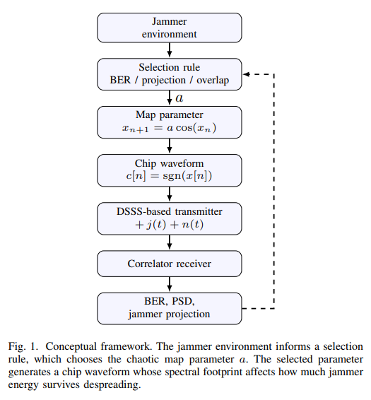
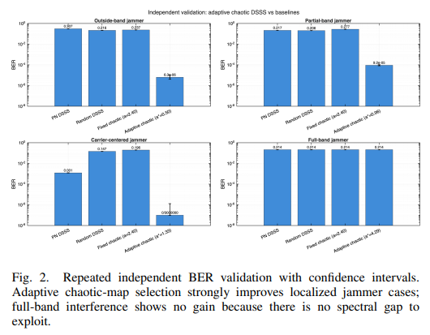
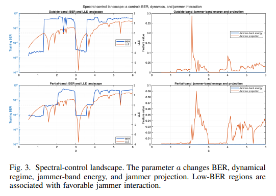
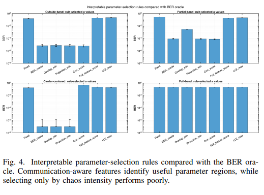
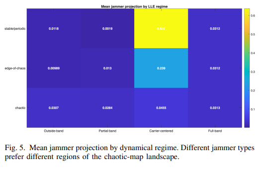
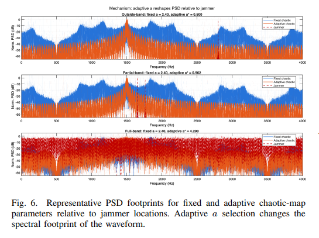
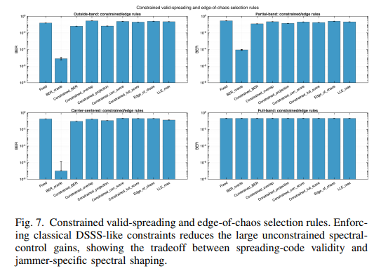

# ISAC+ Beamforming in Joint Communications and Perception: A Mixed Beamforming Design Based on Deep Expansion with a Fast Optimization Method [with Python Code]

Adaptive Spectrum Control with Chaos Mapping: A New Anti-Interference Scheme for Direct Spreading Communications
I. Article Title: Interference Reduction Technology for Direct Broadcasting Communication Based on Adaptive Chaotic Map Spectrum Control
II. Main Content (I) Abstract In the context of direct sequence spread spectrum (DSSS) communication with structural interference, this paper proposes a tunable frequency spectrum control mechanism based on parameterized chaotic mapping to achieve interference suppression.
Traditional chaos-based spread spectrum only uses the chaos sequence as a fixed alternative to pseudo-random (PN) sequences. In contrast, this study controls the chaos mapping parameters as control variables, relying on iterative formulas to dynamically switch communication code pulse waveforms between stable states, periodic states, chaotic critical states, and fully chaotic states. The experiments compared four schemes: traditional PN direct spread, random direct spread, fixed parameter chaos spread spectrum, and adaptive chaos mapping, testing them for four typical interference scenarios: out-of-band interference, partial frequency band interference, carrier center interference, and full frequency band interference.
Numerous independent simulation results show that when facing local suppression interference, unconstrained adaptive parameter selection can significantly reduce the system bit error rate (BER). However, when interference covers the entire frequency band and there is no available spectrum gap, this scheme cannot bring performance improvement. By combining the characteristics of interference projection, spectral overlap, and sequential correlation, it can more accurately screen out the optimal parameter range compared to the method that relies solely on chaos intensity (Liyapunov index).
Additional Constraints Experimental Verification: Mandatory retention of the inherent characteristics of traditional DSSS spread codes can diminish the performance gains brought by spectrum shaping. This reveals an inherent trade-off between the effectiveness of traditional spread codes and their adaptive spectrum shaping capabilities. Research has shown that chaos mapping not only serves as a pseudorandom sequence generator but can also be constructed into a tunable spectrum encoding system. Its effective working range is determined by the communication-level spectrum and related characteristics, rather than solely by the chaotic intensity.
(II) Introduction to Research
1. The shortcomings of traditional Direct Sequence Spread Spectrum (DSSS) communication are directly addressed in this study. The core principle involves using high-speed coded sequences to modulate raw data symbols, spreading the signal energy across a wider bandwidth. At the receiving end, local synchronization coded sequences are used for correlation demodulation to achieve processing gain and resistance to interference.
However, traditional DSSS commonly employs fixed pseudo-noise (PN) sequences, Gold sequences, and Walsh sequences as static spread spectrum codes, which have fatal flaws: the code type and spectral pattern cannot be dynamically adjusted. When enemy jammers target specific frequency bands, signals with fixed spectral distribution are easily interfered with, significantly reducing their anti-interference capabilities.
2. The current state of research on chaos-based spread spectrum is characterized by its sensitivity to initial conditions, parameter sensitivity, noise-like characteristics, and reproducibility, making it naturally suited for generating coded sequence patterns. Over the years, it has been widely applied in communication systems such as chaos DSSS, DS-CDMA, and chaos keying.
Previous studies mostly focus on static comparisons: selecting a certain type of chaos map and fixing parameters, only verifying whether "chaos sequences can replace traditional PN sequences" without exploring the regulatory value of chaos parameters.
3. The core idea and research objective of this paper differ from traditional studies. Instead of focusing on "sequence replacement," we define the chaos mapping parameters as spectral control variables. By choosing the cosine chaos map and adjusting parameters, the system can traverse through four different dynamical states: stable, periodic, chaotic, and completely chaotic. Different states will produce distinct coded statistical characteristics and power spectral density (PSD).
In a local interference environment, appropriately adjusting parameters can transfer signal energy from the interference-strong frequency band to the pure frequency band, achieving active avoidance of interference. This paper argues that the anti-interference performance of chaos-based spread spectrum systems is dominated by factors such as spectral overlap degree, interference projection, and sequence correlation, rather than being solely determined by the strength of chaos. The study also integrates multiple dimensions of indicators including bit error rate, spectral characteristics, coded characteristics, and Lyapunov exponent (LLE, representing the strength of chaos), completing the design, comparison, and verification of the scheme.
(III) Core Technology and Implementation Method
1. Overall System Model
(1) Signal modulation model: Original binary bits are mapped to bipolar symbols, then multiplied with a bipolar code chip sequence to achieve spread spectrum: Chaos sequence generation rule: Take the continuous numerical output of the chaos mapping as the sign, obtaining binary code chips:
Experiment setup for four types of transmitter schemes for cross-comparison:
1. Traditional PN direct spread; 2. Random sequence direct spread; 3. Fixed parameter chaos spread (base group, fixed); 4. Adaptive chaos mapping spread (dynamically select parameters based on interference environment).
(2) Channel and reception model: The received signal is uniformly modeled as: where is the transmitted signal, is the interference signal, and is the additive Gaussian white noise. Experiment setup for four typical interference types: out-of-band single tone interference, partial frequency band interference, carrier center interference, and full band Gaussian interference (without spectral gap, serving as control group).
Receiver uses coherent correlation demodulation: Adds the received signal with local synchronized code chips, determines the positive or negative bit based on the correlation result, and counts the system bit error rate. The experiment assumes ideal timing synchronization, and the receiver knows the current chaos parameters, leaving the synchronization and parameter signaling issues for subsequent engineering implementation.
2. Chaos Map Spectrum Control Principle
The core innovation of this paper: treating parameters as a spectrum tuning knob. Under the premise of fixed chaos mapping and initial values, parameter changes will change the state distribution of the iterative sequence. After taking symbols to generate code chips, directly changes the signal spectrum distribution. The entire control logic is closed loop: interference environment → parameter selection rules → chaos parameters → code chip waveform generation → wireless transmission → receiver demodulation → evaluate bit error rate, spectrum, and interference suppression effect.
3. Five Major Parameter Selection Rules
To achieve automatic parameter optimization, multiple discrimination rules are designed, using "Global Optimal Bit Error Rate (BER oracle)" as the performance upper limit benchmark:
1. Optimal Bit Error Rate Criterion: Traverse all parameters, select the one with the lowest bit error rate, only as a theoretical optimal reference, not used for real-time engineering;
Minimum Spectral Overlap Criterion: Calculate the overlap coefficient between the signal spectrum and the interference spectrum, prioritizing the parameter with the lowest overlap to avoid interference in the frequency domain.
3  
Minimization of Interference Projection: Calculate the interference components remaining after de-spreading, and select the parameter with the smallest interference residual.
4  
Related characteristic criteria: Considering both spectrum and code chip autocorrelation characteristics, avoiding the high sidelobes of sequence autocorrelation to degrade communication performance.
5  
Chaos Strength Criterion: Traditional approach, only selecting the parameters with the maximum Lyapunov exponent (chaos strongest).
At the same time, code card quality evaluation indicators are introduced: balance of code card, density of transition, sidelobes of autocorrelation, and spectrum center / bandwidth / flatness. These are used to constrain the basic communication attributes of spread-spectrum codes.
4. Simulation experiment configuration: All schemes are normalized to the average power of the unit, ensuring fairness in comparison. The core simulation parameters are as follows:
Chaotic Mapping: The parameter scanning range is 120 sampling points.
Bit rate: 32; Signal-to-noise ratio (SNR): 12 dB; Interference power: 20 dB higher than the signal.
Training phase: 12 sets of tests, each set with 100,000 bits; validation phase: 30 sets of tests, each set with 100,000 bits.
Constraints (traditional DSSS characteristics): Code chip imbalance, code chip transition density.
The experiment is divided into two groups: the unconstrained group only pursues optimal anti-interference; The constraint group enforces the balance, step-up characteristics, and correlation properties of traditional spread spectrum codes, simulating real-world engineering scenarios.
(IV) Experimental Results and Core Conclusions 1. Overall Performance (Bit Error Rate, BER) 1
Adaptive chaos spectrum control performance overwhelms traditional schemes and fixed chaos spread spectrum in local interference scenarios (out-of-band, partial frequency bands, carrier center interference).
Out-of-band interference: fixed chaos BER = 0.2368, adaptive scheme reduces to;
Partial Band Interference: Fixed chaos with BER=0.2773, adaptive scheme reduces to;
Carrier center interference: Adaptive scheme zero bit error rate in 3 million bits test.
2  
All schemes in the full-band interference scenario maintained a bit error rate of around 0.214, with no gain from the adaptive strategy. The reason: Interference covers all spectrum, signal energy cannot be transferred to an available frequency gap, and frequency regulation is completely lost.
Conclusion 1: The effectiveness of this technology depends on the existence of local interference and the availability of spectrum gaps in the system.
2. The adaptability rules for different dynamic states are divided into three categories: stable / periodic state, chaotic critical state, and completely chaotic state. Different disturbances adapt to different states:
Out-of-band interference: The residual interference of chaos critical state is the smallest, and the anti-interference is optimal.
Partial band interference: Stable / Periodic state shows the best performance;
Carrier center interference: The strongest ability to suppress interference is in the completely chaotic state.
Total band interference: The performance of three categories is completely consistent.
Conclusion 2: There is no "universal optimal chaos state," and the type of disturbance determines the optimal dynamical regime; therefore, one should not solely pursue high chaos intensity.
3. Parameter selection rules comparison: the traditional approach of relying solely on "chaos intensity" to select parameters is extremely poor. The three types of communication characteristics rules, namely spectral overlap, interference projection and sequence correlation, select the parameters to perform infinitely close to the theoretical optimal value.
Conclusion 3: Judging the performance of chaos spread spectrum, communication spectrum and related characteristics are far more important than the intensity of chaos.
4. Performance trade-offs due to traditional spread spectrum constraints, when forcing the code chip balance, reasonable hopping, and low autocorrelation as traditional DSSS characteristics, the anti-interference gain of the adaptive scheme significantly decreases: taking out-of-band interference as an example, the error rate after the constraint rises from 0.0648.
This indicates:
Unconstrained Chaos Parameters: Extreme Spectrum Shaping, with the strongest interference resistance, but some parameters no longer possess traditional spread spectrum code characteristics.
Constraints on chaotic parameters: compatible with existing DSSS systems, good engineering compatibility, but anti-interference capability decreases.
Conclusion 4: The inherent trade-offs of chaos adaptive spectrum control exist: the standardization of traditional spread spectrum codes and the anti-interference capability of spectrum shaping cannot be simultaneously optimized.
(5) Summary of the Whole Text and Future Prospects 1. Research Summary
Based on the cosine chaotic map, a parameter-adjustable dynamic spectrum control system can be constructed. The parameters can drive signals to switch between various dynamics states and flexibly change the spectrum distribution.
2  
In the face of out-of-band, partial frequency bands, carrier center and other localized structural interferences, adaptive chaos spectrum control can achieve a number of bit error rate reduction; no improvement under full band interference.
3  
The method of distinguishing by interference projection, spectrum overlapping and sequential correlation is an effective way to realize real-time parameter selection. It is not scientific to rely solely on chaos intensity selection.
4  
The positioning of chaos mapping is redefined: it is not only a pseudorandom sequence generator, but also a programmable spectrum encoding platform. At the same time, the traditional DSSS characteristics and frequency spectrum anti-interference capabilities have a trade-off relationship.
2. Future research directions 1
Expand to more types of chaotic maps, verify the universality of the solution.
2  
Add interference real-time classification algorithm, realize interference identification + parameter adaptive full process automation;
3  
Conduct hardware testing based on software radio (SDR) to promote technology implementation;
4  
Develop an online real-time feature extraction algorithm to break away from offline training and achieve true real-time dynamic regulation.

## Images

<!-- PAYMENT_BLOCK -->

## Get this dataset

- Payment link (Stripe): [Buy now](https://buy.stripe.com/3cs8yP7sY87d0vu9AB)
- Payment QR code: 

<!-- /PAYMENT_BLOCK -->
